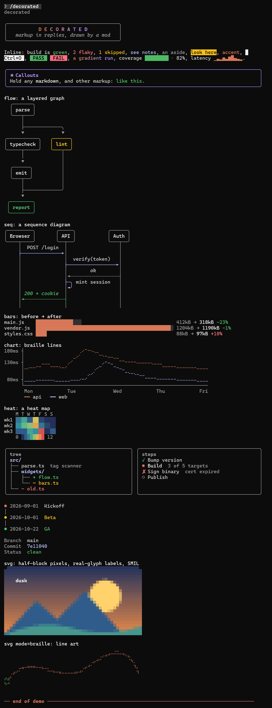

# decorated

A Claude Code mod that lets Claude draw in its replies. Claude writes a small tag
language alongside its Markdown, and the mod draws it in place: colored spans and
badges, callouts, checklists, file trees, bar charts with before → after deltas,
braille line charts, heat maps, sparklines, flow and sequence diagrams, timelines,
side-by-side panels and inline SVG.

> [!NOTE]
> **decorated is experimental.** The tags, the guide that teaches them and how
> often Claude reaches for them may all change between versions. Feedback is the
> point of this release: a drawing that came out wrong, a terminal it breaks in,
> a reply Claude over- or under-decorated. Please
> [open an issue](https://github.com/thomas-whitaker1/decorated/issues); see
> [CONTRIBUTING.md](CONTRIBUTING.md#reporting-a-problem) for what helps.

<p align="center">
  
</p>

```
Tests are <ok>green</ok> after the fix; one <warn>flaky</warn> case remains.

<bars title="Suite time" unit="s" better="lower">
unit: 41 -> 12
integration: 188 -> 140
</bars>
```

Claude uses the tags only where a picture says more than prose. Wide drawings fall
back to a plain list on narrow terminals. Run `/decorated` to see every tag drawn.

## Install

At the prompt of a Claude Code terminal session (v2.1.299 or later):

```
/plugin install decorated --marketplace thomas-whitaker1/decorated
```

From a shell:

```
claude plugin install decorated --marketplace thomas-whitaker1/decorated
```

## Use

The mod teaches Claude its tags through the system prompt, alongside any output
style. `/decorated off` stops the teaching (kept across sessions), `/decorated on`
brings it back. `/decorated low`, `medium` (the default) or `high` sets how much
the guide asks Claude to decorate, also kept across sessions: low keeps to
colored words and badges, with a block only where it is plainly the clearest
form; high draws a block whenever a reply has a shape. Every level teaches the
same tags. Where another reply mod teaches tags of the same names, decorated
steps aside for it, so one mod teaches and draws them.

The guide is about 860 tokens at every level, sent with each request while the
tags are taught. It is cached with the rest of the system prompt; switching the
tags on or off, or changing the level, misses the cache for one request.
Headless runs (`claude -p`) get no guide.

### Steadier decoration through CLAUDE.md

The level says how much to decorate in general. Lines in a `CLAUDE.md` can say
which replies get which drawing, for steadier results: in `~/.claude/CLAUDE.md`
for every project, or in one project's own. Add only the lines you want:

```markdown
## Decorated replies

When the system prompt carries the "Decorated replies" guide:
- Report test, build and lint results with a `<badge>` per check, and compare
  timings or counts with `<bars>`.
- Track multi-step work with `<steps>`, updated as each step finishes.
- Show the files a change touched as a `<tree>` with `+ ` `- ` `~ ` marks.
- Put the one caveat the reader must not miss in a `<callout tone="warn">`.

Without that guide, write plain Markdown: nothing draws the tags.
```

Keep the condition in the first line. decorated draws tags in a reply even when
it is not teaching them, but where nothing draws them the tags show raw. A
`CLAUDE.md` rule without it asks for tags in `claude -p` output and after
`/decorated off` too.

## Compatibility

Claude Code **2.1.299 or later**. Builds up to 2.1.296 refuse a prop decorated
draws with, so there it teaches Claude no tags and says why on the status
line. A plugin manifest cannot declare a minimum version, so the install does
not stop you.

Checked on 2.1.309 in October 2026:

| Where | Draws | Notes |
|---|---|---|
| Terminal, fullscreen | yes | SVG animations play |
| Terminal, main screen | yes | SVG animations show their final frame |
| Claude Desktop | yes | SVG drawn natively; the vertical lines of flow, tree and seq drawings show small gaps |
| VS Code extension panel | partly | replies draw; `/decorated` shows plain text, as the panel draws a command's output itself |
| Phone, through Remote Control | no | replies show as plain text |

| Terminal | Draws | Notes |
|---|---|---|
| Windows Terminal | yes | |
| VS Code integrated terminal | yes | |
| conhost | partly | the fractional blocks of bars, sparklines and meters are missing glyphs |
| kitty 0.41 (Linux) | yes | |
| Ghostty 1.3 (Linux) | yes | |
| tmux 3.2 and 3.5 | yes | 256 colors unless `CLAUDE_CODE_TMUX_TRUECOLOR=1` is set: heat maps and SVG gradients band |
| iTerm2 | untested | decorated draws only text: box drawing, braille, half blocks, 24-bit color |

Light and dark themes both read well: tones follow the theme, and heat maps
pick text that contrasts with each cell. With `NO_COLOR` set, every drawing
keeps its shape in one color. Drawings wider than the window fall back to a
list; at 50 columns nothing overflows.

**Other reply mods.** A mod seated above decorated that draws a reply itself
replaces decorated's drawing; one that rewrites the reply's text or wraps its
drawing works with it. A mod seated beneath decorated sees every reply, but
on one that holds tags its drawing and any rewrite of the text give way to
decorated's: a mod that watches replies (prompt-rail) sees them all, while
open-links does not make the links in those replies clickable. Replies
without tags reach every mod as usual.

## Security

decorated only draws. Its module uses no network, no files (`$.fs`), no
processes (`$.process`) and no model calls. `claude plugin validate` lists
every engine call it makes: the clock (for animation frames), its
`/decorated` command, the system prompt (to add its guide), the session's
version, its own state and store, the status line, and drawing. Across
sessions it stores two values: whether `/decorated off` turned the teaching
off, and the level `/decorated low|medium|high` set.

It reads every reply that holds its tags, so what a reply can ask of it
is bounded:
- parsing takes time linear in the reply: an 80,000-character reply
  costs about 15 ms per streamed update;
- an `<svg>` stops at 80 rows, 4,000 elements, 48 levels of nesting and
  a fixed amount of raster work, about 0.2 s; past that it draws what
  it got to;
- a `<flow>` past 100 nodes or 300 edges is listed instead of laid out,
  a `<tree>` draws 32 levels, and callouts and columns nest 8 deep.

On Claude Desktop and the VS Code panel an `<svg>` goes to the surface's
own SVG element. decorated writes that markup out again without scripts,
event handlers, `<style>`, `<image>`, `<foreignObject>`, or any link or
`url()` pointing outside the drawing, so a drawing loads nothing from
elsewhere.

## Known issues and limitations

Most of these are in the tables above; this is the whole list in one place.

- **Claude decides when to draw.** The level and `CLAUDE.md` steer it; neither
  guarantees it. Expect the odd reply with a tag it didn't need, or none where
  one would have helped.
- **Older Claude Code.** Below 2.1.299 decorated teaches nothing, and the
  install doesn't warn you: only the status line says so.
- **Phone (Remote Control):** nothing draws; replies show as plain text.
- **VS Code extension panel:** replies draw, but `/decorated` shows its gallery
  as plain text.
- **Claude Desktop:** the vertical lines of flow, tree and seq drawings show
  small gaps.
- **conhost** (the old Windows console): bars, sparklines and meters show
  missing-glyph boxes for their fractional blocks. Windows Terminal is fine.
- **tmux:** 256 colors unless `CLAUDE_CODE_TMUX_TRUECOLOR=1` is set, so heat
  maps and SVG gradients band.
- **iTerm2** is untested.
- **SVG animation** plays only in the terminal's fullscreen layout, and an
  endless loop plays only in the newest reply that has one. Everywhere else a
  drawing shows its final frame.
- **Another reply mod teaching the same tags** makes decorated step aside for
  the whole session, not reply by reply.
- **open-links** doesn't make the links in a decorated reply clickable.
- **Big drawings are cut short** at the bounds under [Security](#security):
  an `<svg>` draws what it got to, a large `<flow>` becomes a list.
- **Headless output** (`claude -p`) is never drawn, so the guide isn't sent
  there; see [the condition above](#steadier-decoration-through-claudemd).

## Contributing

Bug reports, terminal results and pull requests are all welcome. See
[CONTRIBUTING.md](CONTRIBUTING.md) for how to develop and test the mod. Agents
working in the repo read [.claude/CLAUDE.md](.claude/CLAUDE.md).

## License

MIT
